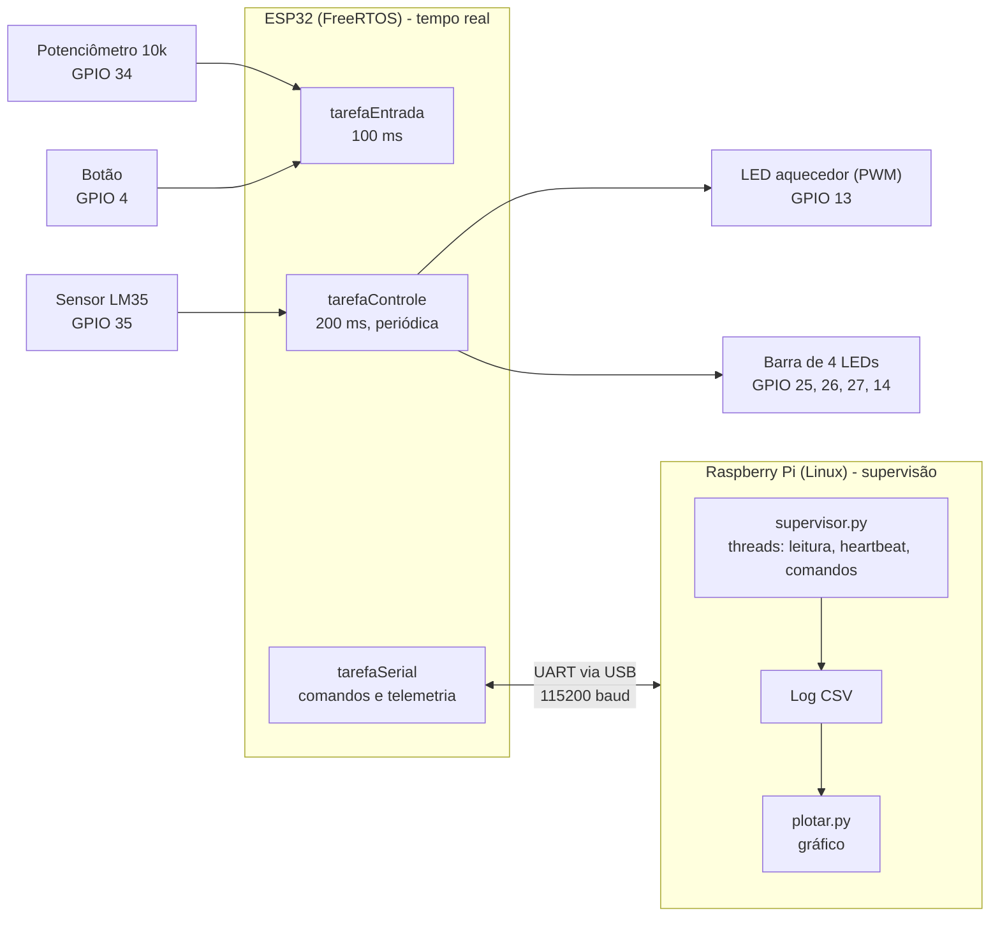
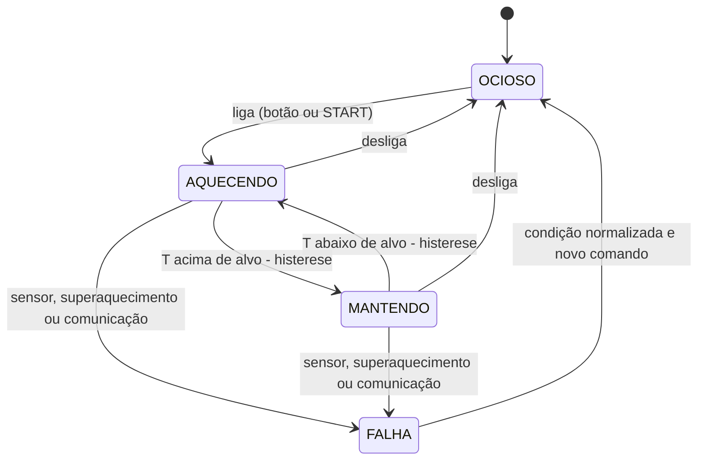
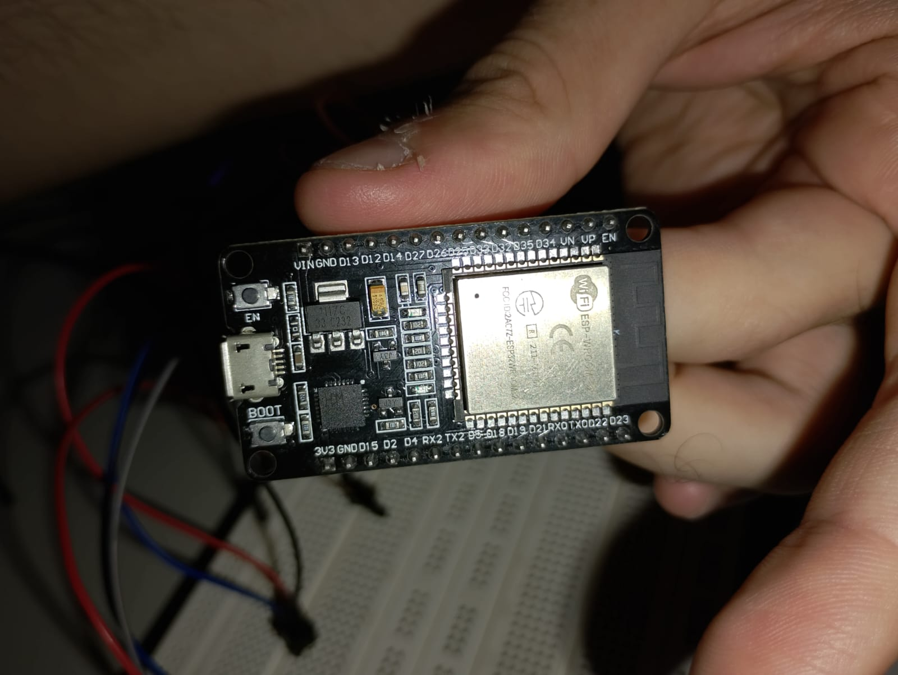
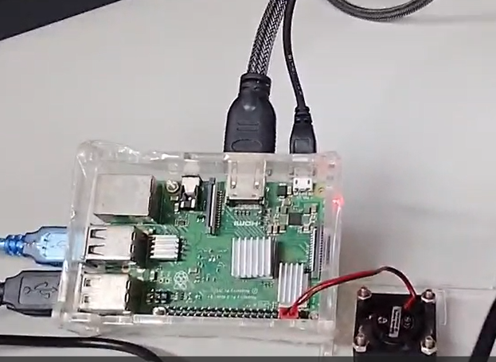
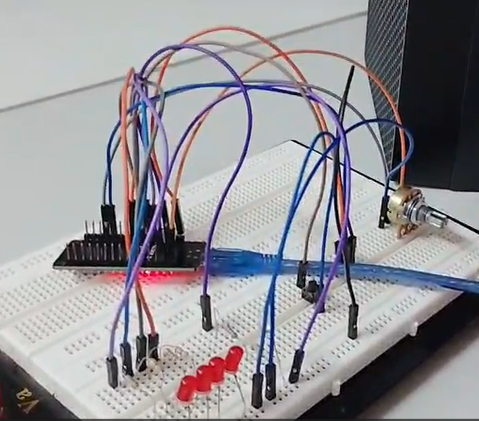
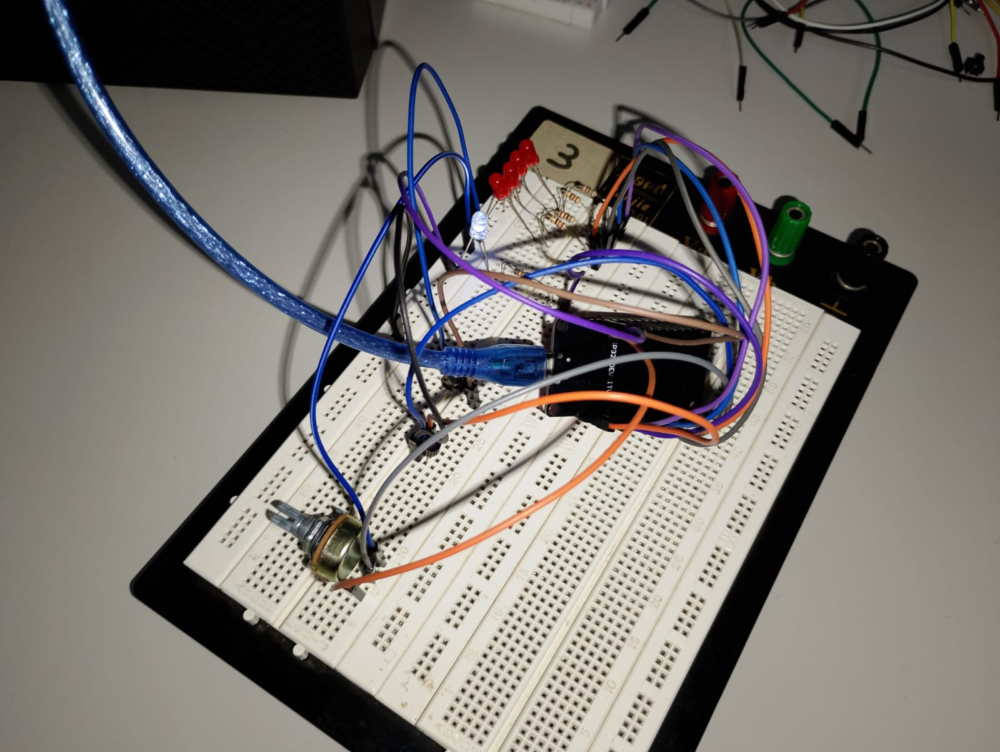
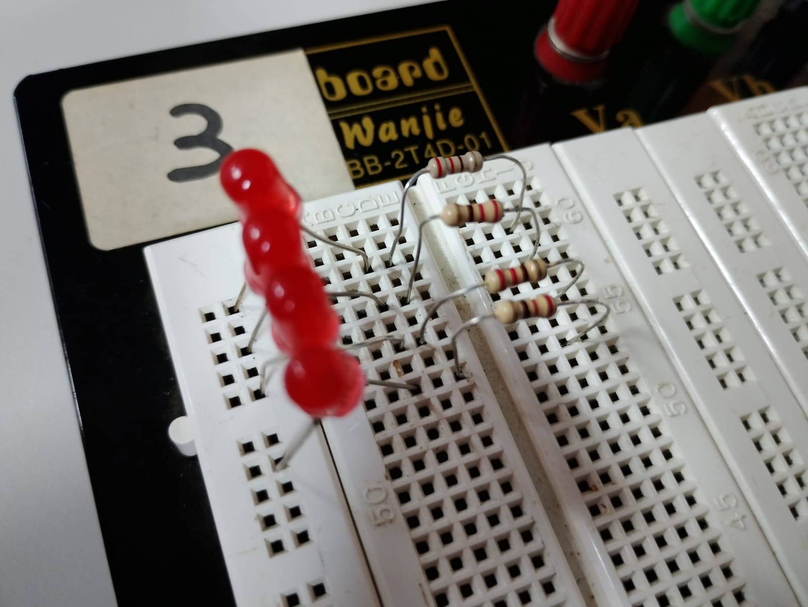
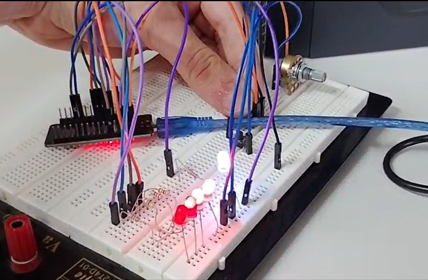

# Forno Inteligente (Air Fryer) com ESP32 e Raspberry Pi

**SEL0630 – Projetos em Sistemas Embarcados** · EESC-USP · Prof. Dr. Pedro Oliveira
**Projeto Final – Parte 3 (tema 3: forno elétrico inteligente)**

| Integrante | Nº USP |
|---|---|
| Daniel Mistieri Foloni | 15446899 |
| Felipe de Oliveira Gomes | 14613841 |

São Carlos, novembro de 2026

---

## Sumário

1. [Descrição do problema e requisitos](#1-descrição-do-problema-e-requisitos)
2. [Arquitetura proposta e justificativa](#2-arquitetura-proposta-e-justificativa)
3. [Divisão de funções entre ESP32 e Raspberry Pi](#3-divisão-de-funções-entre-esp32-e-raspberry-pi)
4. [Comunicação entre os dispositivos](#4-comunicação-entre-os-dispositivos)
5. [Lógica de controle](#5-lógica-de-controle)
6. [Hardware e ligações](#6-hardware-e-ligações)
7. [Software e como reproduzir](#7-software-e-como-reproduzir)
8. [Resultados](#8-resultados)
9. [Limitações e trabalhos futuros](#9-limitações-e-trabalhos-futuros)
10. [Relação com a Parte 2 (co-design)](#10-relação-com-a-parte-2-co-design)
11. [Referências](#11-referências)

---

## 1. Descrição do problema e requisitos

Uma *air fryer* é um forno elétrico de bancada com circulação forçada de ar. Para funcionar, ela precisa medir a temperatura, decidir quando aquecer, informar o estado ao usuário e se proteger de falhas. Este projeto implementa um protótipo desse sistema de controle, seguindo o tema 3 do roteiro da Parte 3: uma arquitetura com **microcontrolador (ESP32)** e **plataforma Linux embarcada (Raspberry Pi)**, com divisão clara de responsabilidades.

O protótipo funciona em **baixa tensão**: o aquecedor é representado por um LED controlado por PWM, e não há nenhuma carga ligada à rede elétrica.

### Requisitos do sistema

| # | Requisito | Situação no protótipo |
|---|---|---|
| R1 | Medir a temperatura com um sensor adequado | Atendido: sensor **LM35** (analógico, lido pelo ADC do ESP32) |
| R2 | Acionar o elemento de aquecimento | Atendido de forma simbólica: **LED com PWM** (brilho = potência) |
| R3 | Ler comandos do usuário | Atendido: **potenciômetro** (temperatura) e **botão** (liga/desliga), além de comandos pela Raspberry |
| R4 | Indicar o estado de operação | Atendido: **barra de 4 LEDs** (temperatura), LED do aquecedor e terminal da Raspberry |
| R5 | Manter a temperatura desejada por uma estratégia de controle | Atendido: **liga-desliga com histerese** (versão PI disponível no código) |
| R6 | Registrar o comportamento térmico | Atendido: **log em CSV** na Raspberry e gráfico gerado a partir dele |
| R7 | Executar tarefas periódicas com RTOS e respeitar restrições de tempo real | Atendido: **FreeRTOS** no ESP32, com tarefa de controle periódica |
| R8 | Tratar falhas com desligamento seguro | Atendido: falha de comunicação, falha do sensor e superaquecimento |
| R9 | Controlar a ventilação (motor/ventoinha) | **Não implementado** neste protótipo (ver [limitações](#9-limitações-e-trabalhos-futuros)) |

---

## 2. Arquitetura proposta e justificativa



### Por que essa arquitetura

- **O controle fica no microcontrolador.** O Linux não garante que uma tarefa rode a cada 200 ms, e o FreeRTOS garante. Por isso a leitura do sensor, a decisão de ligar o aquecedor e as proteções ficam no ESP32. Mesmo sem a Raspberry, o forno continua funcionando de forma segura.
- **O Linux fica com o que é de alto nível.** Interface, registro em arquivo, gráficos e comandos remotos são mais simples de fazer em Python no Raspberry Pi, e não têm prazo rígido.
- **O ADC fica no ESP32.** O Raspberry Pi não possui conversor analógico-digital, então o LM35 (analógico) precisa ser lido pelo ESP32.
- **Comunicação por UART sobre USB.** É assíncrona, simples, ponto a ponto e suficiente para as poucas dezenas de bytes por segundo trocadas. Dispensa conversor de nível (os dois lados trabalham a 3,3 V no sinal) e alimenta o ESP32 pelo mesmo cabo.

---

## 3. Divisão de funções entre ESP32 e Raspberry Pi

| | ESP32 (FreeRTOS) | Raspberry Pi (Python) |
|---|---|---|
| Lê potenciômetro, botão e LM35 | ✔ | |
| Filtra a leitura do sensor | ✔ | |
| Decide ligar/desligar o aquecedor (controle) | ✔ | |
| Aciona o LED do aquecedor (PWM) e a barra de LEDs | ✔ | |
| Detecta falhas e desliga o aquecedor | ✔ | |
| Envia telemetria | ✔ | |
| Recebe e exibe a telemetria | | ✔ |
| Registra os dados em CSV | | ✔ |
| Gera o gráfico da curva térmica | | ✔ |
| Envia comandos (`set`, `start`, `stop`, `pot`) | | ✔ |
| Envia o heartbeat (`PING`) | | ✔ |

---

## 4. Comunicação entre os dispositivos

A comunicação é uma **UART a 115200 baud**, que passa pelo cabo USB entre o ESP32 e a Raspberry (aparece como `/dev/ttyUSB0` ou `/dev/ttyACM0`). As mensagens são linhas de texto terminadas em `\n`, fáceis de depurar no Monitor Serial.

### ESP32 → Raspberry (telemetria, a cada 500 ms)

```json
{"t":24.3,"alvo":60,"pwm":100,"estado":"AQUECENDO","modo":"POT"}
```

| Campo | Significado |
|---|---|
| `t` | Temperatura medida (°C) |
| `alvo` | Temperatura desejada (°C) |
| `pwm` | Potência do aquecedor (0 a 100 %) |
| `estado` | Estado do forno (ver abaixo) |
| `modo` | Origem do alvo: `POT` (potenciômetro) ou `REMOTO` (comando da Raspberry) |

### Raspberry → ESP32 (comandos)

| Comando | Efeito |
|---|---|
| `SET <temp>` | Define o alvo pela Raspberry (modo `REMOTO`) |
| `POT` | Volta a usar o potenciômetro como alvo |
| `START` / `STOP` | Liga / desliga o forno |
| `PING` | Heartbeat, enviado a cada 1 s |

Os comandos são digitados no terminal do `supervisor.py` em letras minúsculas (`set 40`, `start`, `stop`, `pot`, `sair`).

### Estados do forno

| Estado | Significado |
|---|---|
| `OCIOSO` | Forno desligado |
| `AQUECENDO` | Ligado, com a temperatura abaixo de `alvo − histerese` |
| `MANTENDO` | Ligado, com a temperatura próxima ao alvo |
| `FALHA_COMM` | A Raspberry parou de responder por mais de 5 s; aquecedor desligado |
| `FALHA_SENSOR` | Leitura do LM35 fora do plausível (fio solto, curto); aquecedor desligado |
| `SUPERAQUEC` | Temperatura acima do limite de segurança; aquecedor desligado |

---

## 5. Lógica de controle



### Controle liga-desliga com histerese

Com o forno ligado, o aquecedor **liga** quando `T < alvo − 2 °C` e **desliga** quando `T > alvo + 2 °C`. Entre os dois limites, mantém o estado em que estava. A histerese evita que o aquecedor ligue e desligue o tempo todo por causa do ruído da leitura.

O código também traz um controlador **PI** (`#define USE_PID 1`), que gera uma potência contínua de 0 a 100 %. Os ganhos `KP` e `KI` foram deixados como ponto de partida e **não foram ajustados** para a planta real, por isso o liga-desliga é a opção padrão.

### Leitura do LM35

O LM35 entrega 10 mV por °C. O ESP32 faz a média de 16 leituras (`analogReadMilliVolts`, que usa a calibração de fábrica do ADC) e aplica um filtro exponencial (α = 0,3) para suavizar o ruído. A constante `LM35_OFFSET` permite corrigir um desvio por comparação com uma referência.

### Modos de operação (`SENSOR_REAL`)

| | `SENSOR_REAL 1` (LM35 real) | `SENSOR_REAL 0` (simulado) |
|---|---|---|
| Fonte da temperatura | Sensor LM35 | Modelo térmico de 1ª ordem calculado no ESP32 |
| Faixa do alvo | 30 a 90 °C | 50 a 200 °C |
| Corte de segurança | 100 °C | 230 °C |
| LEDs da barra acendem em | 35, 50, 65 e 80 °C | 40, 80, 120 e 160 °C |

> O LM35DZ mede de 0 a 100 °C, por isso o modo real tem faixa reduzida. O modo simulado reproduz a faixa de um forno de verdade e foi mantido como alternativa. **[Ajuste esta tabela se vocês alteraram os valores no código para o teste.]**

---

## 6. Hardware e ligações

### Materiais

| Item | Quantidade |
|---|---|
| ESP32 DevKit (ESP32 Dev Module, módulo ESP-WROOM-32) | 1 |
| Raspberry Pi **[modelo]** com Raspberry Pi OS | 1 |
| Sensor de temperatura LM35DZ | 1 |
| Potenciômetro linear 10 kΩ (B10K) | 1 |
| Botão de pinos (*push button*) | 1 |
| LED vermelho (barra de temperatura) | 4 |
| LED **[cor]** (aquecedor) | 1 |
| Resistor 220 Ω (um por LED) | 5 |
| Capacitor 100 nF (opcional, filtro do LM35) | 1 |
| Protoboard e jumpers, cabo USB | – |

### Pinagem do ESP32

| Pino | Função | Observação |
|---|---|---|
| GPIO 35 | Saída do LM35 | Entrada do ADC1 |
| GPIO 34 | Cursor do potenciômetro | Entrada do ADC1 |
| GPIO 4 | Botão | Pull-up interno; o outro terminal vai ao GND |
| GPIO 13 | LED do aquecedor | PWM de 5 kHz, 8 bits, com resistor de 220 Ω |
| GPIO 25, 26, 27, 14 | Barra de 4 LEDs | Cada um com resistor de 220 Ω |
| VIN (5 V) | +Vs do LM35 | O LM35 precisa de pelo menos 4 V |
| 3V3 | Extremo do potenciômetro | Nunca ligar o potenciômetro ao VIN |
| GND | Todos os negativos | GND comum |
| USB | Raspberry Pi | Alimentação e comunicação serial |

### Placas utilizadas



*Placa ESP32 DevKit utilizada no protótipo.*



*Raspberry Pi utilizada para supervisão, registro dos dados e comunicação serial.*

### Esquemático



*Detalhe da montagem na protoboard e das ligações da barra de LEDs.*

### Montagem



*Montagem completa do protótipo na protoboard.*



*Detalhe da faixa de LEDs e dos resistores.*

---

## 7. Software e como reproduzir

### Estrutura do repositório

```
.
├── README.md
├── esp32/
│   └── forno_esp32_lm35/
│       └── forno_esp32_lm35.ino     # firmware do ESP32 (FreeRTOS)
├── raspberry/
│   ├── supervisor.py                # leitura, log, comandos e heartbeat
│   └── plotar.py                    # gráfico a partir do CSV
└── docs/
    ├── esquematico/                 # esquemático do circuito
    ├── imagens/                     # fotos e capturas de tela
    ├── video/                       # vídeo da demonstração
    └── logs/                        # exemplo de log CSV e gráfico
```


*Visualização da estrutura do repositório no VS Code.*

### Firmware do ESP32

1. Instale a Arduino IDE e o pacote de placas **esp32** (Espressif).
2. Abra `esp32/forno_esp32_lm35/forno_esp32_lm35.ino`. A pasta precisa ter o mesmo nome do arquivo `.ino`.
3. Em **Tools → Board**, selecione **ESP32 Dev Module** e escolha a porta.
4. Confira as opções no início do arquivo: `SENSOR_REAL` (1 = LM35, 0 = simulado) e `USE_PID` (0 = liga-desliga, 1 = PI).
5. Faça o *upload*. Se a gravação travar em `Connecting...`, segure o botão **BOOT** da placa até começar.
6. Para conferir, abra o Monitor Serial a **115200 baud**: deve aparecer uma linha de telemetria a cada 500 ms.

### Supervisor na Raspberry Pi

```bash
sudo apt install python3-serial python3-matplotlib
ls /dev/ttyUSB* /dev/ttyACM*          # descobrir a porta do ESP32
cd raspberry
python3 supervisor.py                  # porta padrão: /dev/ttyUSB0
python3 supervisor.py /dev/ttyACM0     # se a porta for outra
```

Feche o Monitor Serial da Arduino IDE antes de rodar o supervisor, porque a porta serial só pode ser usada por um programa por vez. Se aparecer "permissão negada", rode `sudo usermod -aG dialout $USER` e reinicie a sessão.

Comandos aceitos no terminal do supervisor:

| Comando | Ação |
|---|---|
| `start` / `stop` | Liga / desliga o forno |
| `set <temp>` | Define o alvo pela Raspberry (ex.: `set 40`) |
| `pot` | Volta a usar o potenciômetro |
| `sair` | Encerra o programa |

Cada execução cria um arquivo `logs/forno_AAAAMMDD_HHMMSS.csv` com as colunas `timestamp, t, alvo, pwm, estado, modo`. Para gerar o gráfico:

```bash
python3 plotar.py logs/forno_AAAAMMDD_HHMMSS.csv
```

### Tarefas FreeRTOS do ESP32

| Tarefa | Período | Prioridade | Função |
|---|---|---|---|
| `tarefaControle` | 200 ms (`vTaskDelayUntil`) | Alta (3) | Lê e filtra o LM35, executa o controle, aciona LED do aquecedor e barra, verifica falhas |
| `tarefaSerial` | Laço de 10 ms; telemetria a cada 500 ms | Média (2) | Recebe comandos e envia a telemetria |
| `tarefaEntrada` | 100 ms | Baixa (1) | Lê o potenciômetro e o botão |

---

## 8. Resultados

O protótipo foi montado e testado no laboratório. Os testes e resultados observados foram:

| Teste | Resultado |
|---|---|
| Telemetria pelo Monitor Serial | Uma linha JSON a cada 500 ms, no formato esperado |
| Leitura do LM35 em repouso | Cerca de 24 °C, estável (variação de décimos de grau) |
| LM35 aquecido com o dedo | A temperatura subiu de forma gradual, até cerca de 30 °C |
| Potenciômetro | Varredura completa do alvo, de 30 a 90 °C |
| Botão | Alterna o estado entre `OCIOSO` e `AQUECENDO`/`MANTENDO` |
| LED do aquecedor | Acende (`pwm` = 100) quando o forno está aquecendo |
| Controle com histerese | Com o alvo em 30 °C, o estado passou a `MANTENDO` por volta de 28 °C (alvo − 2 °C) e voltou a `AQUECENDO` quando o sensor foi solto e esfriou |
| Barra de LEDs | **[descrever o comportamento observado]** |
| Supervisor na Raspberry | **[descrever: telemetria no terminal, comandos `start`, `set`, `stop`, `pot`]** |
| Log e gráfico | **[inserir o gráfico gerado pelo `plotar.py`]** |
| Fail-safe (`FALHA_COMM`) | **[descrever, se testaram: parar o supervisor e verificar o desligamento do aquecedor após 5 s]** |

### Teste de aquecimento do LM35



*Teste de resposta do sensor LM35 ao aquecimento manual.*

### Demonstração


[Vídeo da demonstração](docs/video/demonstracao.mp4)

> **[Inserir as fotos, o vídeo e o gráfico.]**

### Problema encontrado durante os testes

O primeiro botão usado era do tipo SMD, de pernas finas e planas, e fazia **mau contato na protoboard**: o ESP32 e o código estavam corretos (um fio encostado entre o GPIO 4 e o GND já alternava o estado), mas o clique não era detectado. A substituição por um botão de pinos resolveu o problema.

---

## 9. Limitações e trabalhos futuros

**Limitações**

- **Faixa de temperatura:** o LM35DZ mede apenas de 0 a 100 °C, e um forno real passa de 200 °C. O protótipo trabalha de 30 a 90 °C. Para a faixa real seria necessário outro sensor, por exemplo um termopar tipo K com módulo conversor.
- **Aquecedor simbólico:** o LED não esquenta o sensor. Nos testes, a temperatura foi variada aquecendo o LM35 com o dedo, o que demonstra a resposta do controle, mas não uma planta térmica real. O modo simulado (`SENSOR_REAL 0`) completa a demonstração com um modelo de aquecimento e resfriamento.
- **Ventilação não implementada:** o roteiro cita o controle de uma ventoinha, que não foi incluído neste protótipo.
- **Controle PI não ajustado:** o liga-desliga com histerese é a estratégia validada.
- **Armazenamento:** o registro é feito em arquivo CSV na Raspberry Pi (microSD), e não no ESP32.
- **Sem interface gráfica:** a supervisão é feita por terminal e gráfico estático.

**Trabalhos futuros**

- Acionar um aquecedor real de baixa tensão (resistor de potência com transistor) e fechar a malha com o LM35.
- Adicionar o controle de uma ventoinha por PWM.
- Ajustar os ganhos do controlador PI a partir da resposta da planta real.
- Criar uma interface web (por exemplo, com Flask) e transformar o supervisor em um serviço `systemd`.
- Incluir atualização de firmware via OTA e estudar uma versão em placa dedicada.

---

## 10. Relação com a Parte 2 (co-design)

Na Parte 2 da prática final foi analisada a escolha entre projetar do zero, usar um CoM ou usar um SBC para o estágio de Desenvolvimento deste mesmo produto. A conclusão foi que a combinação **SBC + microcontrolador de desenvolvimento** é a mais viável para o protótipo (menor custo, risco e prazo), enquanto um produto final seria melhor atendido por uma placa dedicada baseada em microcontrolador. Este projeto implementa justamente a arquitetura indicada para a fase de Desenvolvimento.

---

## 11. Referências

1. Espressif Systems, *ESP32 Series Datasheet*. <https://www.espressif.com/sites/default/files/documentation/esp32_datasheet_en.pdf>
2. Texas Instruments, *LM35 Precision Centigrade Temperature Sensors – Datasheet*. <https://www.ti.com/lit/ds/symlink/lm35.pdf>
3. Raspberry Pi Ltd., *Raspberry Pi 4 Model B Datasheet*. <https://datasheets.raspberrypi.com/rpi4/raspberry-pi-4-datasheet.pdf> **[trocar pelo datasheet do modelo usado, se for outro]**
4. Material da disciplina SEL0630: roteiro do Projeto Final (Partes 1, 2 e 3).
